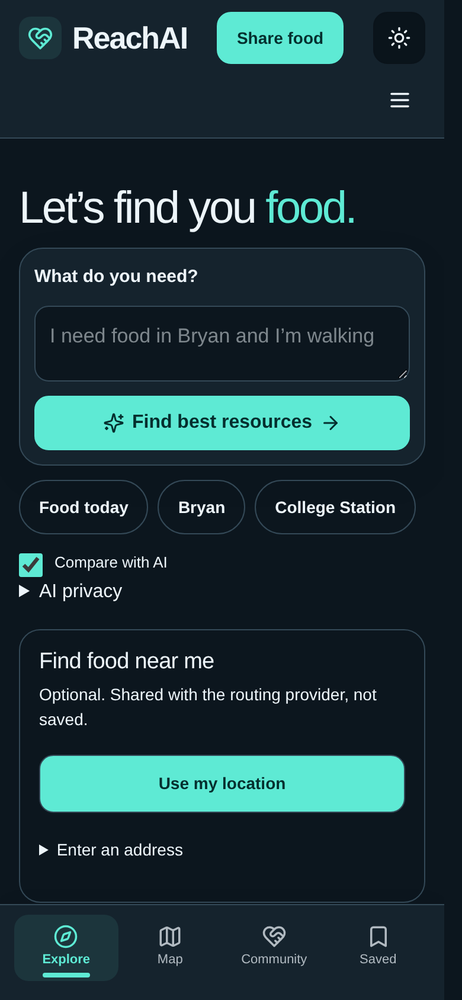
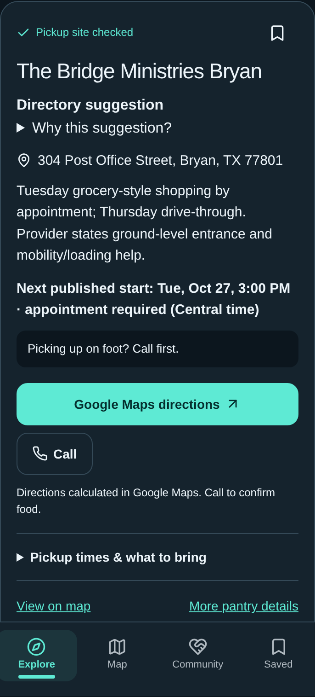
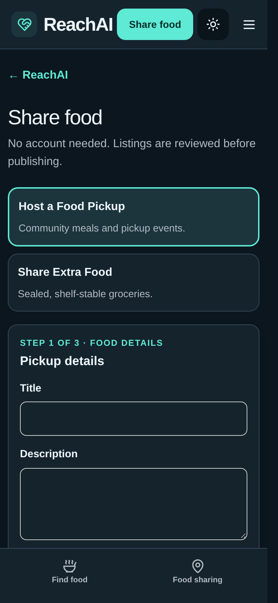

# ReachAI

### Find food. Find a way forward.

ReachAI helps people find food assistance and plan a practical next step. Search in everyday language, compare pickup options, check published requirements, and open directions—all without creating an account.

Built by **Raman Jamal** (Bryan High, 11th grade) and **Aran Jamal** (Davila, 7th grade) for the **Congressional App Challenge**.

[Get started](#run-locally) · [Features](#what-you-can-do) · [Configuration](#configure-ai-and-maps) · [Data and limits](#data-you-can-trace) · [Documentation](#learn-more)

> **Branch note:** The current ReachAI experience is on `improve/food-first-experience`. The `main` branch contains an older version. The setup command below checks out the current version. This repository does not establish that a public demo is deployed.

## A look inside

<table>
  <tr>
    <th>Find food</th>
    <th>Review a pickup</th>
    <th>Share food</th>
  </tr>
  <tr>
    <td></td>
    <td></td>
    <td></td>
  </tr>
</table>

Actual local screenshots from October 25, 2026. Some labels have since been simplified; pantry call buttons now display phone numbers. These images do not demonstrate a live AI response or current food availability.

## What you can do

- **Find food without an account.** Search by city, ZIP code, listing name, or a request such as “I need food in Bryan and I’m walking.”
- **Compare options.** View up to three matching suggestions based on available location, pickup-time, and requirement information. Fewer matches means fewer suggestions—not invented results.
- **Get AI-assisted explanations.** When configured, Groq helps interpret a request and summarize source-backed options. Directory search remains available if AI is disabled or unavailable.
- **Choose your starting point.** Use browser location, enter an address, or select a map pin. Address lookup and map rendering depend on configured providers.
- **Plan the next step.** Read published pickup details, call an organization, view the map, or open Google Maps directions. Routed travel information needs a working routing provider.
- **Keep useful information.** Save places on your device; the trip planner supports saved itineraries, downloads, and printing. Including a precise origin in a saved trip requires consent.
- **Share food locally.** Submit a community event through **Host a Food Pickup**, or sealed, shelf-stable groceries through **Share Extra Food**.
- **Moderate community listings.** Administrators review submissions and photos, approve or reject listings, and remove approved listings from public results while retaining review history.

## Data you can trace

The maintained directory contains **66 pantry and food-distribution sites**, following the October 25, 2026 source review. It focuses on the **119th Congress Texas District 10 boundary (2025–2027)**, including Bryan–College Station and other reviewed communities.

This is **not an exhaustive directory**. The count includes restricted programs, such as senior grocery distributions, rather than 66 unrestricted walk-in pantries. Approved, active community submissions can appear alongside maintained listings.

Each maintained record carries source information and a checked date. Read the [coverage audit](docs/TX10-COVERAGE-AUDIT.md) and [independent 66-site review](docs/TX10-SIXTY-REVIEW.md) for evidence, exclusions, and unresolved details.

### Important limits

- Published hours do not guarantee food, holiday operation, or admission. Call before traveling when details are uncertain.
- ReachAI shows known eligibility requirements, but does not fully determine whether an individual qualifies.
- Map pins are not proof of a safe walking entrance or wheelchair access.
- Straight-line distances are labeled separately from provider-calculated routes. A Google Maps link asks Google to calculate directions; it is not proof that ReachAI retrieved an itinerary.
- The main discovery experience does not provide live bus tracking or a verified public-transit itinerary. Historical transit/planner documents are not a promise of current service.
- AI can be wrong. It explains available information; it cannot confirm inventory, eligibility, or a guaranteed “best” pantry.

## Run locally

**Requirements:** Node.js **24** (see [`.nvmrc`](.nvmrc)), npm, and Git. Node 18 and 20 are not the supported runtime for this project. SQLite uses Node’s built-in database support and needs a writable local filesystem.

```sh
git clone --branch improve/food-first-experience https://github.com/returnedlegend/Reach.git
cd Reach
npm ci
npm run dev
```

Open **http://127.0.0.1:3000**. The development server binds to your own computer; this is not a public deployment.

Basic directory browsing does not require an API key. For provider configuration, create `.env.local` from [`.env.example`](.env.example) **only if you do not already have a local environment file**:

```sh
# Linux / macOS: preserve any existing configuration.
[ -f .env.local ] || cp .env.example .env.local
```

```powershell
# Windows PowerShell:
if (!(Test-Path .env.local)) { Copy-Item .env.example .env.local }
```

Review the settings before enabling external services, then restart the development server. Never commit `.env.local`, API keys, private databases, or uploaded identity documents.

## Configure AI and maps

| Capability | What it needs | When unavailable |
| --- | --- | --- |
| Directory search and listing details | Local application and database | No hosted AI key required |
| AI interpretation and summaries | Server-only Groq key, enabled feature, and accepted provider data policy | Directory results remain usable |
| OpenStreetMap-derived basemap | Configured map style and network access | Textual listings remain available |
| Address lookup | Compliant geocoding configuration | Choose browser location or an available map pin; browse by city or ZIP |
| Walking/driving route details | Configured Valhalla-compatible routing service | No invented distance or time; external directions remain available |

### Hosted AI

The default adapter is **Groq**; no Ollama installation is required. Configure these server-side values in `.env.local` or your host’s environment settings:

```ini
REACH_AI_PROVIDER=groq
REACH_RELEASE_AI=true
GROQ_API_KEY=your_groq_api_key_here
GROQ_MODEL=openai/gpt-oss-20b
# Enable only after reviewing the provider's data-processing terms:
REACH_AI_DATA_POLICY_ACCEPTED=true
```

Use `REACH_AI_PROVIDER=disabled` to run without AI. The ranking request can send user-entered text, public listing facts, and derived travel comparisons to the provider; do not include private information in prompts. No raw origin coordinates are sent by that ranking pipeline.

Run `npm run ai:check` to check configured access. `npm run ai:check -- --generate` additionally sends a small synthetic generation request and uses provider quota. A configured key is not proof of successful live inference or free, unlimited usage. See [Groq setup](docs/GROQ.md) and [how ranking works](docs/AI-PANTRY-RANKING.md).

### Maps and directions

The normal map uses **MapLibre GL JS** with an OpenStreetMap-derived basemap. **Google API credentials are not required.** Geocoding and routing remain separate integrations, disabled until configured. Follow [OpenStreetMap setup](docs/OPENSTREETMAP.md), including attribution, rate limits, and public-provider usage policies. Public demonstration servers are not guaranteed production infrastructure.

## Sharing and administrator access

Public submissions are at **`/share`**. No public account registration is required. Listings are reviewed before publication; household sharing uses approximate public locations and requires pickup arrangements.

Provision your own administrator from a trusted terminal:

```sh
npm run admin:setup -- administrator@example.org
```

This prompts for a temporary password **visible in that local terminal**. Use a private terminal, choose a strong password, then sign in at **`/admin/sign-in`** and change it at **`/admin/change-password`**. Setup refuses to overwrite an existing identity. Review submissions at **`/admin`**.

The app checks moderator permissions on the server. Passwords are hashed; sensitive requests use origin checks, validation, and rate limits. Uploaded photos are validated and re-encoded. These controls reduce risk but are not a security certification.

See [administrator setup](docs/AUTHENTICATION.md), [sharing workflow and removal](docs/FOOD-SHARING.md), and [food-sharing safety rules](docs/FOOD-SHARING-SAFETY.md). Use synthetic data for testing; do not upload real government IDs.

## Development and verification

```sh
npm run data:validate  # Validate maintained and separate demo datasets
npm run typecheck     # TypeScript checks
npm test              # Unit and integration tests
npm run build         # Production build
npm run check         # All four checks above
```

The full check also needs Python 3 for the retained transit-import tests. Set `REACH_PYTHON` if Python is not on your PATH.

Browser testing uses Playwright:

```sh
npx playwright install chromium
npm run test:e2e -- tests/simple-food.spec.ts --project=mobile --project=desktop
```

The Playwright configuration starts a local server when `REACH_TEST_URL` is unset. Use `REACH_TEST_URL` for an existing test server and `PLAYWRIGHT_CHROMIUM_PATH` for an installed Chromium executable. These are browser-emulated viewports, not physical-device tests. Use isolated test data; sharing/admin suites have additional setup requirements. Some older browser suites still target retired UI controls—do not treat their presence as proof that every current workflow passes.

Earlier implementation checks recorded **662 unit tests** and successful type/build checks; the simplified food-search flow separately passed **14 mobile/desktop browser checks**. These are dated results, not a live CI badge or a claim that external services work today. See [verification records](docs/VERIFICATION.md) and [judge-style review](docs/JUDGE-REVIEW-2026-10-25.md).

## Architecture

| Layer | Technology / responsibility |
| --- | --- |
| Web application | Next.js 16, React 19, TypeScript |
| Interface | Tailwind CSS 4, daisyUI 5, dark-first mobile layout |
| Persistent storage | SQLite on a private, writable filesystem |
| Map rendering | MapLibre GL JS and configurable OSM-derived tiles |
| Search and comparisons | Maintained directory facts and application ranking logic |
| Optional language assistance | Server-side Groq adapter with validated responses |

```text
src/app/          Pages and server API routes
src/components/   Search, maps, sharing, and admin interfaces
src/lib/          Ranking, providers, validation, auth, and storage
src/data/         Maintained resource definitions
data/research/    Source evidence and reviewed candidate records
tests/            Automated checks and isolated fixtures
docs/             Setup, research, architecture, and verification
deploy/           Single-host deployment configuration
```

## Hosting

Local installation is different from publishing. A public deployment needs HTTPS, the exact canonical `REACH_APP_ORIGIN`, private persistent storage, backups, administrator provisioning, and verified provider configuration. A temporary or read-only serverless filesystem is not suitable for the default SQLite setup.

Follow the [single-host publishing guide](docs/PUBLISHING.md). No public demo URL is claimed here. Test the deployed search, sharing, moderation, and failure states before inviting users.

## Learn more

- [Documentation index](docs/README.md) — navigation to technical and research documents; older reports describe earlier iterations.
- [Development guide](docs/DEVELOPMENT.md) — setup and troubleshooting.
- [Architecture](docs/ARCHITECTURE.md) — storage and service boundaries.
- [Source and coverage audit](docs/TX10-COVERAGE-AUDIT.md) — how listings were reviewed.
- [Challenge slides and speaker notes](docs/presentation/README.md) — editable presentation and actual app screenshots.
- [Report an issue](https://github.com/returnedlegend/Reach/issues) — describe reproducible bugs or listing corrections without posting private information.

To suggest a pantry correction, include a public authoritative source and the affected listing. Do not invent schedules, accessibility claims, or eligibility rules. This repository currently has no license file; do not assume unrestricted reuse. Third-party maps, data, and dependencies have their own terms and attribution requirements.
