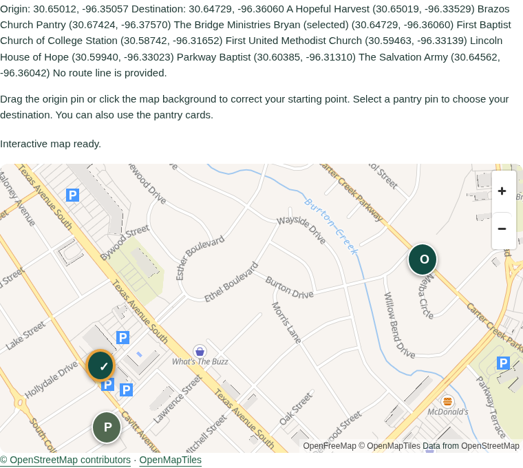

# OSM migration verification

Independent review completed 2026-10-17. This document separates controlled fixtures from real provider traffic.

## Provider-policy review

Sources were actually fetched on 2026-10-17:

- [OpenFreeMap overview](https://openfreemap.org/) says its public service requires no API key, permits commercial use and unlimited map views/requests, and offers no SLA. Attribution requires OpenMapTiles and OpenStreetMap; OpenFreeMap credit is appreciated. [Terms](https://openfreemap.org/tos/), dated October 14, 2026, describe an as-is service. This application does not download offline map areas.
- [Nominatim usage policy](https://operations.osmfoundation.org/policies/nominatim/) limits all application users together to one request per second, requires an identifying User-Agent or Referer, suitable attribution and caching, prohibits autocomplete and systematic queries, and prohibits submitting personal/confidential material. Its current LLM section requires a deliberate informed developer decision before using the public service; environment opt-in and documented limitations are necessary. A filesystem lock can enforce an aggregate limit only for processes sharing the same host and cache directory. Multiple independent replicas require a different shared limiter or a different/self-hosted provider.
- [Valhalla official README](https://github.com/valhalla/valhalla#demo-server), retrieved through its raw GitHub endpoint, identifies the FOSSGIS demo and permits fair use under the usual OSRM/Nominatim limits. It requests notification through GitHub Discussions and an identifying `X-Client-Id` when publishing apps to end users. This local prototype is not a public deployment. Public demo availability is not a production promise. The FOSSGIS wiki returned an anti-bot challenge, so its contents were not treated as verified and the challenge was not bypassed.

## Evidence boundaries

- The recovered baseline reported 116 unit tests plus build/data/type validation. `/tmp/reach-osm-baseline-ready/.last-run.json` records the earlier browser run; this is baseline evidence, not migration verification.
- `tests/osm-verification.spec.ts` intercepts map style/tile and service responses in ordinary runs. It uses the real bundled MapLibre SDK; it does not emulate the renderer. Controlled map pixels and routes are test fixtures, not evidence that an external provider returned correct cartography or a safe route.
- A live provider smoke, if completed below, represents a small number of requests at the recorded time. It cannot establish continuing availability, pedestrian access, safe crossings, pantry entrance accuracy, food availability, or transit operation.

## Migration results

The OSM checks below completed against the final production build. Main-agent review accepted the independent findings, with the direct-browser TLS and provider-configuration limitations retained.

**Final combined result: 74 distinct browser cases passed across phone and desktop, including targeted reruns.** The legacy regression run passed 50 cases and exposed two outdated exact-response assertions: the migrated endpoint correctly returned HTTP400 with an added `reason` field. Those assertions were updated and passed on both viewports. Two planning-API cases excluded by the initial test filter also passed, producing 54 distinct legacy cases. The 20 OSM cases below complete the 74-case suite. This was not a single clean run. Evidence: `/tmp/reach-osm-final-regressions.log`, `/tmp/reach-osm-api-recheck.log`, and the OSM logs below. Final TypeScript validation also passed after test edits. Saved trips, download, print, missed-bus timing, service holidays, manual-origin precision, and unavailable-provider behavior passed regression checks.

### Completed independent checks

- Production build served at the internal test URL on port 3037. The main verification command completed data validation, TypeScript, **152 unit tests**, and production build successfully (`/tmp/reach-osm-final-check.log`, reported and checked with the main agent).
- **20 distinct OSM browser checks passed** across mobile (390×844) and desktop (1280×900). The production run completed 16 passes; four test-assumption failures were corrected and all four passed in the targeted rerun. The failures concerned a newly duplicated attribution link selector and a simulated drag leaving the map's bounds. These are recorded rather than presented as a single clean run. Evidence: `/tmp/reach-osm-final-independent.log` and `/tmp/reach-osm-final-targeted.log`; targeted `.last-run.json` says `passed` with no failed tests.
- Browser checks use the actual bundled MapLibre renderer and same-origin worker, native marker buttons, pointer dragging, keyboard pantry selection, persistent canvas across pantry changes, correct selected pantry/card state, visible attribution, no horizontal overflow, and zero detected WCAG A/AA violations in the map region. They also cover explicit search (no keystroke requests), keyboard search-result selection, manual entry after search failure, explicit reverse lookup preserving the selected coordinate, invalid API coordinates, unavailable transit without invented geometry, route-provider failure, provider geometry/legend clearing on failed recomputation, and map-provider failure/retry.
- A separate cross-process check replaced `fetch` independently in three Node processes and exercised the real shared filesystem limiter: two searches and one reverse lookup dispatched **1,099 ms and 1,102 ms apart**, exceeding the public one-request-per-second ceiling. The nominal timer buffer is 1,100 ms; dispatch measurement has millisecond scheduling variation. No external service was called by this concurrency check. [Recorded evidence](evidence/osm-cross-process-rate.json).
- Static import/request review found no Google SDK or Google API dependency in the current application path. The unimported legacy adapter remains for historical tests. Optional external Google Maps directions links remain user-initiated handoffs.

### Broader application regression results

The final production verification covers **74 distinct mobile/desktop browser checks**: 20 OSM checks above and 54 existing application checks. The broader run completed 50 passes and two failures caused by an old exact-response assertion omitting the new structured `reason` field. The assertion was updated while preserving HTTP-400 validation and absence-of-geometry checks; a targeted run passed those two cases plus two previously filtered planning-API cases. Thus all 74 distinct checks have passing evidence after corrections; this was **not one uninterrupted clean run**. Logs: `/tmp/reach-osm-final-regressions.log` and `/tmp/reach-osm-api-recheck.log`. TypeScript was checked again after the test edits.

### Real provider evidence

On October 17, 2026, the actual server adapter made a small isolated verification run: one public-place search for Bryan, Texas; one reverse lookup of the public city-center point; and one Valhalla walking request from that center to the published Bridge distribution site. Each returned HTTP 200. The Nominatim dispatches were **1,100 ms apart**. Repeating the search and route in the same process returned cached results with no extra provider requests. Only the verification process opted into the services; the application defaults remain disabled. No personal address was submitted.

The routing request used Valhalla's **`pedestrian`** costing. It returned **2.1576 miles, approximately 40.85 minutes, six instructions, and 60 geometry points**. These are provider estimates, not field verification of safe pedestrian access or the pantry entrance. [Actual adapter responses and request metadata](evidence/osm-live-services.json).

Ordinary Chromium connections to the live tile host failed with `ERR_CERT_AUTHORITY_INVALID` in this cloud environment. TLS verification was preserved. A separate live rendering check forwarded actual provider responses through Node's TLS-validating fetch, using the supplied environment proxy and certificate configuration (`NODE_USE_ENV_PROXY=1`). **All 16 forwarded responses returned HTTP 200** (12 distinct URLs, including style, fonts, and vector tiles). The real MapLibre worker rendered Bryan streets and labels, nine native markers (eight pantries plus origin), OpenMapTiles/OpenStreetMap attribution, and no Google SDK requests. This is real downloaded cartography rendered in Chromium, with an explicitly different network transport; it does not establish direct Chromium HTTPS readiness.

[Live-rendering request evidence](evidence/osm-live-map.json). Deterministic browser tests use fixture cartography; this screenshot uses the actual provider data.

### Defects found and resolved

- MapLibre v6's default worker location was incompatible with the Next/Turbopack bundle. The owner added the supported explicit worker URL emitted as a same-origin asset; actual browser rendering subsequently passed.
- Concurrent identical geocoder submissions could enqueue repeated requests. The backend owner added bounded in-flight coalescing; provider unit tests confirm eight concurrent identical submissions make one provider call.
- A trailing-dot public hostname could evade the public-provider classification. The owner canonicalized public hostnames before applying opt-in and limiter requirements.
- Persistent attribution now remains visible independently of map loading, and native pantry targets meet the app's minimum touch size.
- The inherited raster test fixture had an invalid PNG chunk checksum. It was replaced with a valid 256×256 test tile; provider-failure assertions were retained.

### Reproduce and limits

For the deterministic OSM checks, start the existing app with `npm run dev -- --port 3000`, then run `REACH_TEST_URL=http://localhost:3000 npx playwright test tests/osm-verification.spec.ts --workers=1`. Ordinary test runs contact no public geocoder/router and replace public map responses with fixtures. Run the repository's `npm run check` for data, types, unit tests and build. The app must use the checked build when evaluating production behavior; rebuilding under an already running production server invalidates that test target.

The memory cache/coalescing is per process; the filesystem dispatch limiter is shared only among processes using the same host, user and directory. This is not a multi-host guarantee. Public Nominatim must remain disabled on unsupported deployment topologies. Its public-service opt-in is a deliberate developer responsibility, not a production-readiness claim. Live routing demos have no production SLA. Bus geometry comes from the published GTFS snapshot and remains scheduled, not live; missing shape segments do not become invented connecting lines. The text/card/manual-coordinate fallback remains available when WebGL, tiles, geocoding or routing fail. No offline tile download, public deployment, live transit feed, or field accessibility audit was performed.
